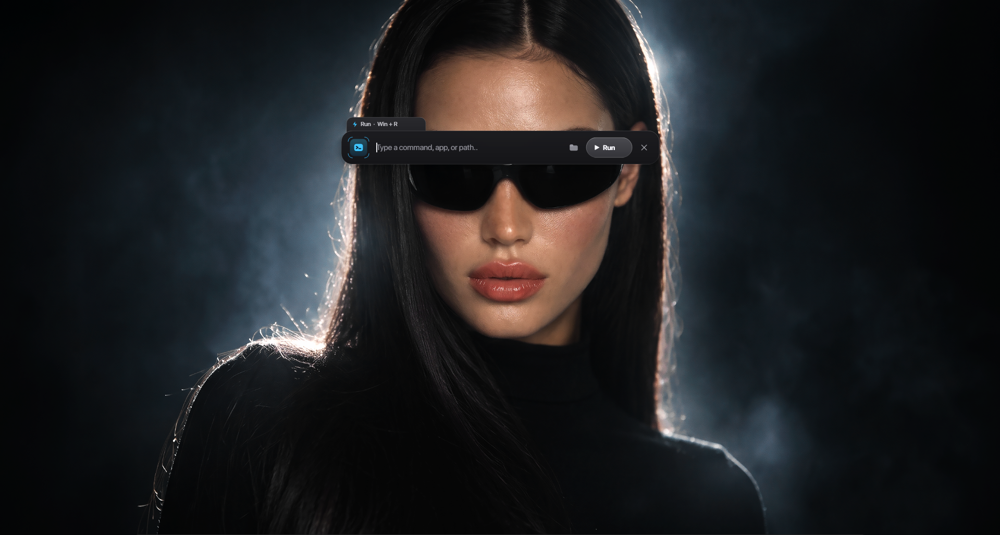

# MPRD - Modern Pill Run Dialog

Replaces the legacy Windows Run dialog (`Win + R`) with a sleek, floating pill command bar built with **DirectWrite anti-aliased typography**, **seamless Apple Glass blur**, clean minimal filled vector icons, live Windows `RunMRU` history, inline autocomplete, quick Admin elevation, and fluid hover & launch polish animations.

## Themes
1. **Minimal 11 (Obsidian Matte)** — Clean dark obsidian matte pill with subtle rim lighting and soft diffused shadow.
2. **Translucent (Apple Glass)** — Seamless creamy frosted glass blur with Apple-style vibrancy and luminous specular edges.
3. **Frosted Light (Apple Light Glass)** — Bright milky macOS/visionOS-inspired light frosted glass with crisp high-contrast dark typography.
4. **Midnight Aurora (Deep Glass + Glow)** — Deep smoked indigo-obsidian glass with a subtle cyan-to-violet ambient rim gradient.

## Key Features
- **DirectWrite Smooth Typography** — Razor-sharp, non-pixelated grayscale anti-aliased rendering (defaults to **Google Sans**, with graceful fallback to Segoe UI Variable / Segoe UI).
- **Custom Favorite Font** — Enter any installed Windows font family directly in Mod Settings.
- **Transparent Background (`10% – 100%`)** — Fine-tune background/glass translucency from a dropdown.
- **Responsive Pill Window (`WIDTHxHEIGHT`)** — Customize width and height cleanly; icons, buttons, padding, and typography auto-scale responsively.
- **Show Run Dialog on Taskbar** — Explicitly registers MPRD on the Windows Taskbar while open (`ITaskbarList` + custom icon).
- **Move Run Dialog with Cursor** — Enable or lock cursor dragging of the floating pill.
- **Authentic Bottom-Left (Classic) Mode** — Sits snugly above the taskbar and unfolds history suggestions upward.
- **Polished Animations** — Smooth top-to-bottom open/close glides, smooth hover animations on every control, animated gradient sweep on the centered Run button, typing glow feedback, and a luminous 360° in-place spin on the left icon before launching.

## Screen Resolution Guide (`1920x1080` and Below)
For **`1920x1080`** displays or smaller, adjust **`Pill Window (px)`** in Windhawk Mod Settings to fit your screen comfortably:

| Screen Resolution | Recommended `Pill Window (px)` |
| :--- | :--- |
| `1280x720` / `1366x768` | `500x54` or `520x56` |
| `1600x900` | `560x58` |
| `1920x1080` (100%–125% DPI) | `580x60` or `620x64` *(default)* |
| `2560x1440` / `4K` | `640x66` or `700x68` |

All inner elements (icons, Run pill button, font size, and corner radius) scale responsively so nothing overlaps or looks distorted.

## Keyboard Shortcuts
- `Enter` — Run command
- `Ctrl + Shift + Enter` — Run as Administrator
- `Tab` or `Right Arrow` — Accept inline autocomplete suggestion
- `Up` / `Down` — Navigate Run history & system commands
- `Esc` — Close dropdown or dismiss dialog
- Click the top-left status tab or left icon badge to toggle **Admin Mode**

---

# MPRD - Modern Pill Run Dialog (Bahasa Indonesia)

Mengganti dialog Run klasik Windows (`Win + R`) menjadi *floating pill command bar* yang modern, bersih, dan responsif dengan **render teks DirectWrite anti-pecah**, **efek blur seamless bergaya Apple Glass**, minimal filled vector icons, sinkronisasi riwayat `RunMRU` Windows, autocomplete instan, mode Admin 1-klik, serta animasi polish yang halus.

## Pilihan Tema
1. **Minimal 11 (Obsidian Matte)** — Permukaan gelap obsidian matte minimalis dengan rim highlight tipis dan bayangan lembut.
2. **Translucent (Apple Glass)** — Efek blur frosted glass seamless ala Apple Glass dengan vibrancy halus dan pinggiran kaca bercahaya.
3. **Frosted Light (Apple Light Glass)** — Kaca buram terang bergaya macOS/visionOS dengan teks gelap kontras tinggi.
4. **Midnight Aurora (Deep Glass + Glow)** — Kaca gelap indigo-obsidian dengan aksen gradasi rim tipis cyan ke violet.

## Fitur Utama
- **Teks Mulus DirectWrite** — Bebas pecah/pixelated dengan font default **Google Sans** (otomatis fallback ke Segoe UI Variable / Segoe UI jika belum terinstall).
- **Custom with your Favorite Font** — Ganti font sesuai selera langsung dari form Settings.
- **Transparent Background (`10% – 100%`)** — Atur tingkat transparansi kaca/background lewat dropdown.
- **Pill Window (px) Responsif (`LEBARxTINGGI`)** — Atur lebar & tinggi pill secara bebas dan responsif tanpa tampilan melenceng.
- **Show Run Dialog on Taskbar** — Menampilkan MPRD secara aktif di Taskbar Windows lengkap dengan icon-nya.
- **Move Run Dialog with Cursor** — Aktifkan atau kunci drag-move pill dengan kursor.
- **Animasi Polish Lengkap** — Animasi buka/tutup dari atas ke bawah, animasi hover halus di seluruh elemen, tombol Run center dengan animasi gradasi saat hover, efek ketik, dan putaran 360° bercahaya pada icon kiri sebelum membuka aplikasi.

## Panduan Ukuran untuk Layar Resolusi `1920x1080` ke Bawah
Untuk pengguna layar resolusi **`1920x1080` ke bawah**, silakan ubah pengaturan **`Pill Window (px)`** di tab **Settings** Windhawk agar proporsional di layar masing-masing:

| Resolusi Layar | Rekomendasi `Pill Window (px)` |
| :--- | :--- |
| `1280x720` / `1366x768` | `500x54` atau `520x56` |
| `1600x900` | `560x58` |
| `1920x1080` (100%–125% DPI) | `580x60` atau `620x64` *(default)* |
| `2560x1440` / `4K` | `640x66` atau `700x68` |

Seluruh komponen di dalam pill (icon, tombol Run, ukuran teks, dan kelengkungan sudut) otomatis menyesuaikan secara responsif.

## Pintasan Keyboard
- `Enter` — Jalankan perintah
- `Ctrl + Shift + Enter` — Jalankan sebagai Administrator
- `Tab` / `Panah Kanan` — Terima saran autocomplete
- `Panah Atas` / `Bawah` — Navigasi riwayat Run & perintah sistem
- `Esc` — Tutup dropdown atau keluar dari Run dialog
- Klik tab status kiri atas atau icon badge kiri untuk mengaktifkan/menonaktifkan **Admin Mode**

---

## Credits
Created & maintained by **[darkostepbro](https://github.com/darkostepbro)** (`github.com/darkostepbro`).
