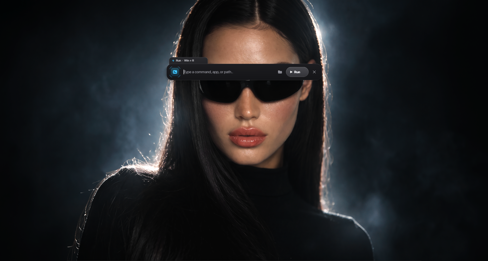

# MPRD - Modern Pill Run Dialog

Replaces the legacy Windows Run dialog (`Win + R`) with a sleek, floating pill command bar built with **DirectWrite anti-aliased typography**, **Windows 11 Acrylic HostBackdrop blur**, clean vector icons, live Windows `RunMRU` history, inline autocomplete, quick Admin elevation, custom rounded corners, and fluid hover & launch polish animations.

## Themes
1. **Translucent 11** — Seamless dark Windows 11 Acrylic frosted blur modeled after *Translucent Seamless* (`TintLuminosityOpacity 0.4`, `TintOpacity 0.35`, subtle Acrylic micro-grain, borderless glass).
2. **Minimal 11** — Ultra-minimalist single expandable dark command bar with outline icons (`🔍`, folder, `( > )`) and inline unified suggestions list.
3. **Frosted Glass** — Translucent liquid glass capsule with bright crystalline rim reflections and a minimal right-arrow (`→`) icon-only action button.
4. **MPRD Legacy** — Classic obsidian matte floating pill with crisp rim lighting and soft diffused shadow.
5. **Midnight Aurora** — Deep smoked indigo-obsidian frosted glass with a subtle cyan-to-violet ambient rim gradient.

## Key Features
- **DirectWrite Smooth Typography** — Razor-sharp grayscale anti-aliased rendering (defaults to **Google Sans**, with graceful fallback to Segoe UI Variable / Segoe UI).
- **Custom with your Favorite Font** — Enter any installed Windows font family directly in Mod Settings.
- **Transparent Background (`10% – 100%`)** — Fine-tune background/Acrylic translucency from a dropdown.
- **Rounded Window (`10% – 50%`)** — Custom border radius applied cleanly to the entire Run dialog window (minimum `10%`, never `0`).
- **Responsive Pill Window (`WIDTHxHEIGHT`)** — Customize width and height cleanly; icons, buttons, padding, and typography auto-scale responsively.
- **Show Run Dialog on Taskbar & Move with Cursor** — Explicitly toggle Windows Taskbar presence and cursor dragging.
- **Authentic Bottom-Left (Classic) Mode** — Sits snugly above the taskbar and unfolds suggestions upward.
- **Polished Animations** — Smooth top-to-bottom open/close glides, smooth hover transitions on every control, animated gradient sweep on the centered Run button, typing glow feedback, and a luminous 360° in-place icon spin before launching.

## Screen Resolution Guide (`1920x1080` and Below)
For **`1920x1080`** displays or smaller, adjust **`Pill Window (px)`** in Windhawk Mod Settings to fit your screen comfortably:

| Screen Resolution | Recommended `Pill Window (px)` |
| :--- | :--- |
| `1280x720` / `1366x768` | `500x54` or `520x56` |
| `1600x900` | `560x58` |
| `1920x1080` (100%–125% DPI) | `580x60` or `620x64` *(default)* |
| `2560x1440` / `4K` | `640x66` or `700x68` |

## Keyboard Shortcuts
- `Enter` — Run command
- `Ctrl + Shift + Enter` — Run as Administrator
- `Tab` or `Right Arrow` — Accept inline autocomplete suggestion
- `Up` / `Down` — Navigate Run history & system commands
- `Esc` — Close dropdown or dismiss dialog
- Click the top-left status tab or left icon to toggle **Admin Mode**

---

# MPRD - Modern Pill Run Dialog (Bahasa Indonesia)

Mengganti dialog Run klasik Windows (`Win + R`) menjadi *floating pill command bar* yang modern, bersih, dan responsif dengan **render teks DirectWrite anti-pecah**, **efek blur Acrylic seamless bergaya Windows 11**, pilihan desain ultra-minimalis, sinkronisasi riwayat `RunMRU` Windows, autocomplete instan, mode Admin 1-klik, custom rounded window, serta animasi polish yang halus.

## Pilihan Tema
1. **Translucent 11** — Efek blur Acrylic gelap seamless bergaya *Translucent Seamless* di Windows 11 Settings Styler (`TintLuminosityOpacity 0.4`, `TintOpacity 0.35`, grain Acrylic halus, kaca tanpa sekat kasar).
2. **Minimal 11** — UI super minimalis dengan satu window menyatu, icon outline bersih (`🔍`, folder, `( > )`), dan daftar saran terintegrasi di dalam kotak yang sama.
3. **Frosted Glass** — Kapsul liquid glass transparan dengan pantulan rim kaca terang dan tombol eksekusi hanya berupa icon panah kanan (`→`) tanpa label teks.
4. **MPRD Legacy** — Permukaan gelap obsidian matte klasik dengan rim highlight tipis dan bayangan lembut.
5. **Midnight Aurora** — Kaca gelap indigo-obsidian dengan aksen gradasi rim tipis cyan ke violet.

## Fitur Utama
- **Teks Mulus DirectWrite** — Bebas pecah/pixelated dengan font default **Google Sans** (otomatis fallback ke Segoe UI Variable / Segoe UI jika belum terinstall).
- **Custom with your Favorite Font** — Ganti font sesuai selera langsung dari form Settings.
- **Transparent Background (`10% – 100%`)** — Atur tingkat transparansi kaca/background lewat dropdown.
- **Rounded Window (`10% – 50%`)** — Custom border radius untuk keseluruhan window Run dialog (minimal `10%`, tidak bisa `0`).
- **Pill Window (px) Responsif (`LEBARxTINGGI`)** — Atur lebar & tinggi pill secara bebas dan responsif tanpa tampilan melenceng.
- **Show Run Dialog on Taskbar & Move with Cursor** — Opsi menampilkan MPRD di Taskbar Windows dan opsi drag/kunci posisi dengan kursor.
- **Animasi Polish Lengkap** — Animasi buka/tutup dari atas ke bawah, animasi hover halus di seluruh kontrol, tombol Run center dengan gradasi hover, efek ketik, dan putaran 360° bercahaya pada icon kiri sebelum membuka aplikasi.

## Panduan Ukuran untuk Layar Resolusi `1920x1080` ke Bawah
Untuk pengguna layar resolusi **`1920x1080` ke bawah**, silakan ubah pengaturan **`Pill Window (px)`** di tab **Settings** Windhawk agar proporsional di layar masing-masing:

| Resolusi Layar | Rekomendasi `Pill Window (px)` |
| :--- | :--- |
| `1280x720` / `1366x768` | `500x54` atau `520x56` |
| `1600x900` | `560x58` |
| `1920x1080` (100%–125% DPI) | `580x60` atau `620x64` *(default)* |
| `2560x1440` / `4K` | `640x66` atau `700x68` |

## Pintasan Keyboard
- `Enter` — Jalankan perintah
- `Ctrl + Shift + Enter` — Jalankan sebagai Administrator
- `Tab` / `Panah Kanan` — Terima saran autocomplete
- `Panah Atas` / `Bawah` — Navigasi riwayat Run & perintah sistem
- `Esc` — Tutup dropdown atau keluar dari Run dialog
- Klik tab status kiri atas atau icon kiri untuk mengaktifkan/menonaktifkan **Admin Mode**

---

## Credits
Created & maintained by **[darkostepbro](https://github.com/darkostepbro)** (`github.com/darkostepbro`).
